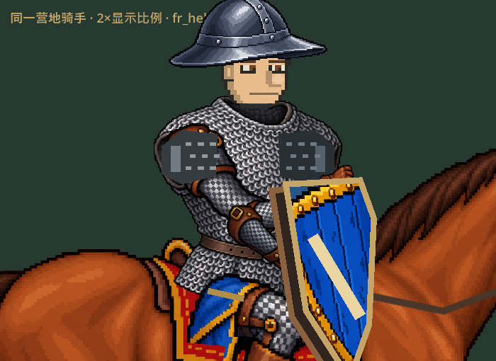
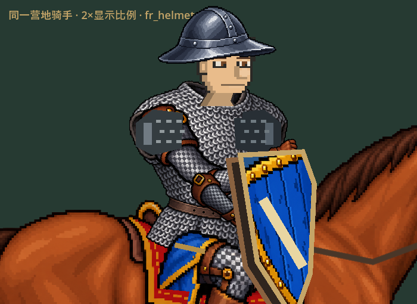
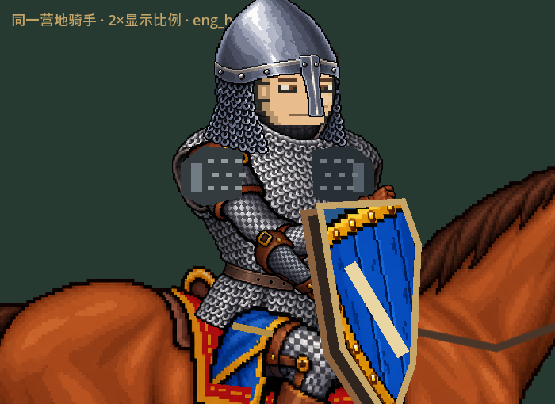
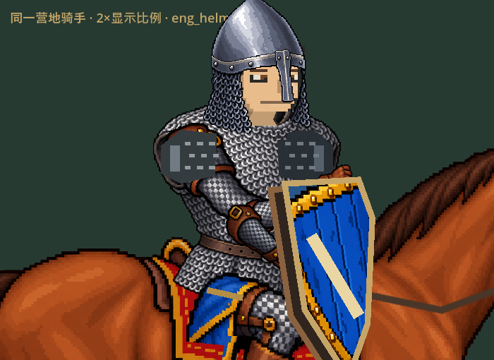

# DEV-053 头颈佩戴返工

2026-10-30 EDT，45分钟授权：22:06:54–22:51:54。基线25a2a04。用户明确否定v0.4.12观感；上轮可运行/像素连接并不能证明适配良好，本轮不沿用其美术验收结论。只返工头、颈、盔与领口，下一次加速/颠簸/音效阶段未启动。

## 诊断与实际改动

- 用户第一图的铁帽与锁甲组合：胸甲有不透明黑色领洞，旧灰色颈柱既太短又没有进入领口；无胡须时下巴直接压在黑圈上。上轮主连通夹具固定长胡须，遮住了这个问题。
- 第二图鼻盔：盔壳宽64，但脸只占名义脸框的部分，整体缩放会把脸一起缩小，仍像宽罩壳。英式鼻盔改为54宽、保持独立脸孔大小；铁帽79→70并下调到与鼻盔接近的眼线。全量观察另发现德式鼻盔同类问题，64→56并重新注册脸孔。保留帽沿、鼻梁条、护颊等形制，不改源PNG或历史资料。
- 新颈部取实际脸框的下颌后半部和同一肤色，形成短颈、下颌暗面与较窄根部。根部固定在胸甲空间的领洞里，头部朝向只影响上端；头组件对中胸甲约3–5单位的视觉偏移，避免向左时仍露第二个空领口。
- 后领在颈后，原胸甲前领像素再覆盖颈根。前领覆绘沿原胸甲UV，并复用实际受击表面变形，避免受击后纹理错缝。落马头框使用相同视觉偏移；规则head锚点、伤害、枪盾限速、输入、装备ID/属性和存档格式不改。
- 四脸型、五种胡须与肤色仍沿用现有代码原生像素脸；本轮改佩戴关系，没有声称重画所有脸或全部24件头盔。

## 迭代与独立审查

| 轮次 | 观察 | 后续处理 |
| --- | --- | --- |
| baseline01 | 生产菜单复现两种头盔配英/法锁甲，正常尺寸与2×特写，无胡须为主 | 不使用长胡须遮挡作为通过依据 |
| candidate01 | 鼻盔改善、右向短颈出现；左向仍像从领洞边缘长出，黑孔过大 | 头对中胸领，根部提前过渡 |
| candidate02 | 左向改善，但右向颈根成过宽肤色梯形 | 缩窄根宽，上端移向下颌后半部 |
| candidate03 | 两反馈组合/四脸型/三胡须/双向俯仰未见原明显悬空或宽罩壳 | 扩至高领、深肤色及其他装备 |
| allfit01 | JSON passed=true，但日志实际出现6条颈阴影三角化错误 | 不判通过；改简单四边形及上下界保护，保留失败日志 |
| allfit02 / poses01 / candidate04 | 全套与混搭、开放盔脸型、无须深肤色高领；修后日志无绘制错误 | 进入实际发布验证 |

[独立美术审查](V053_ART_REVIEW.md)由head_art_review053根据实际图片给出；[独立代码复核](V053_CODE_REVIEW.md)由head_qa053执行，发现领口受击错位并复核修复。QA夹具由head_qa053编写，所有引擎串行运行由root执行；不是独立真人试玩。

## 验证范围

- Godot4.5.1实际GPU、Compatibility；全部使用QA路径，窗口最小化，无前台编辑器或鼠标键盘占用。
- 新test_head_wear_v053：同一生产main菜单的正常显示尺寸、同fighter 2×特写，四脸型×无须/络腮/长须、双向三姿态、最深肤色无须高领，共12图。保存成功不等于审美通过，需看图片。
- 原全量头肩夹具190组合用于发现断开风险；原开放盔/极值20页用于回归，不能替代无须主夹具。
- 最终headless导入正常。发布EXE/PCK、落马、实际接触和ZIP回执在完成后追加。

## 实际发布与最终复验

运行源码`dfde0ecfeed951295e92e42bdfe6a9b464278c05`。实际v0.4.13 EXE不传`--path`，从PCK加载生产资源，测试脚本从外部QA目录启动。

| 证据 | 结果 | 范围 |
| --- | --- | --- |
| export-wear01 | 12张图完成；8张特写/脸型/俯仰/深肤高领与candidate04逐一SHA相同，4张首页版本页脚不同 | 实际菜单角色；无须优先，不用图像连接断言代表观感 |
| export-battle01 | 26例实际扫掠接触、断枪、实战头部KO与落马，11015ms，空failures | 保留原数值、有限控制；自动初态，非真人比赛 |
| export-fall01 | 六种部位/朝向完整落马，全部停稳，空failures | 新头框偏移与原肢体/落地轮廓配合 |
| export-head-contact01 | 英/法/德0号盔×双向共6例真实head接触/完整落马脱手，8185ms，空failures；已目视三款命中图，接触落在可见头盔/额部附近 | 初始HP=1、盾关闭的专项夹具，不表示正常血量必秒杀，不宣称轮廓精确碰撞 |
| unzip-smoke01 | ZIP独立解压后菜单/军械库/历史、竞技场与实战各三轮及结算，9图，约76秒完成后退出 | 生产主场景自动驱动，没有OS键鼠或真人手感结论 |

上述最终发布日志及allfit02/poses01/candidate04没有ERROR/WARNING/SCRIPT ERROR/triangulation记录；allfit01失败日志保留。代码审查者另读取发布动态证据复核，未把阅读日志冒充亲自运行。

PCK SHA256：`077B8D151D2799834ED9A51E7F7185B99B33565E14AB1641C13FAEFA846FEF62`；EXE：`78CCC576E8F8BFFD7EF6AD6F36EBD72A41E609A1052225A55B3407C96EA84065`；Windows ZIP：`90D37E7B50ECFDEF76089EE71829B865B0B624004AAC8BDE4F5BCFE46DDBB5E2`。解压后EXE/PCK散列一致，旧.12 PCK保持`BD09369DEEA7E36A1A80DC1D445EBA9EEB7DF5260638806D3FF88EBA06204EF3`。正式档与先前归档一致，散列记录在logs/v053/release-manifest.json。Play-Latest在验包后指向.13。

### 同尺寸实际引擎对照

| v0.4.12基线 | v0.4.13实际包 |
| --- | --- |
|  |  |
|  |  |

对照图是同一生产角色2×显示比例的GPU输出，非修图效果图；实际菜单大小另保留home_*图。本轮素材修改为现有渲染代码和佩戴数据，无ImageGen位图修改。

## 保留限制

没有穷举24×24所有头胸混搭，也没有把玩家体验判定交给断言数。部分夸张头盔造型、粗方肩护片与细密胸甲的风格密度差异仍在；本轮没有整套肩臂重画。头部玩法仍用原圆形近似，新增约3–5单位视觉对中须看真实命中图，不宣称轮廓级盔甲物理。OS原生输入与用户最终满意度未验收。

原有Claude文档和历史QA未覆盖；正式档散列仍与任务前已知归档一致。完整PNG保留本地，选取前后菜单/特写、深肤高领和动态证据入库；原始日志包括失败，不删改历史失败以求通过。
