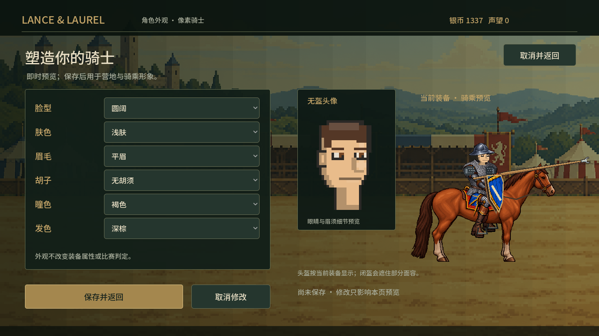
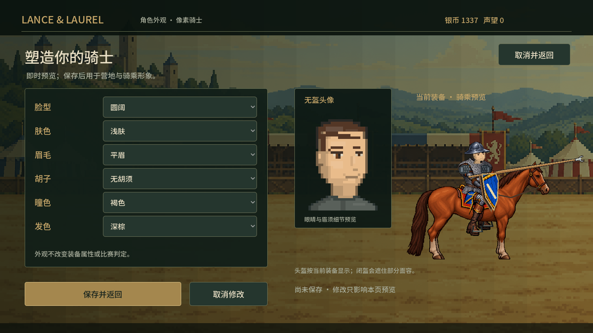
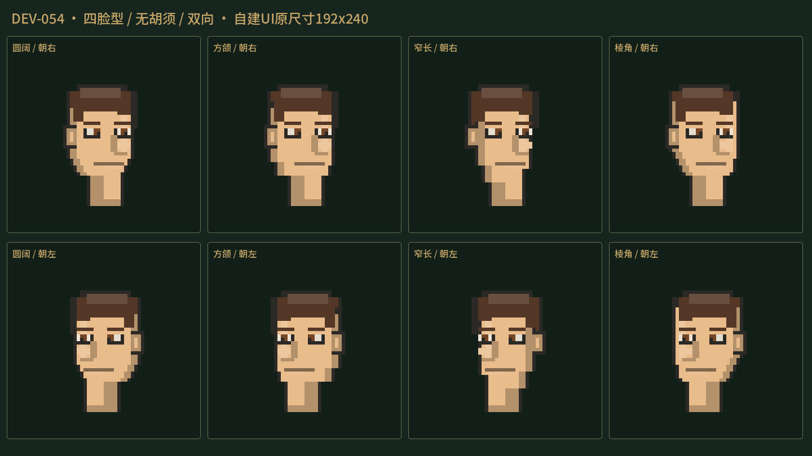
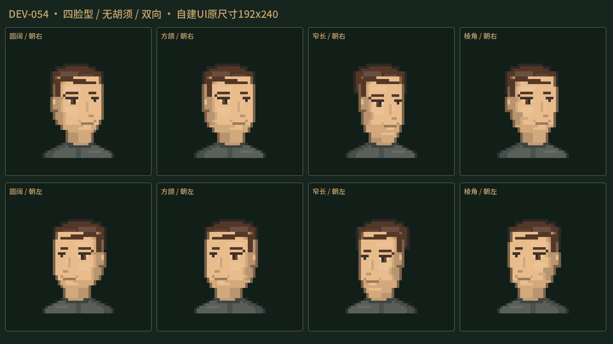

# DEV-054 自建像素脸返工

2026-10-30 EDT，基线aa753bc。用户认为v0.4.13自建脸木讷、五官难看，要求自然的pixel art。本轮修改面部设计，不再次用头盔贴合、像素连通或规则断言来替代审美。没有启动下一次加速/重击音阶段，也没有新设时间预算。

## 问题与实现

旧实现给近远眼都画5×3黑框、两行眼白；鼻子是长竖阴影接4×2亮块，嘴是一条9像素直线，脸颊平坦，轮廓变化对五官没有影响。这解释了“木脸”感，而不是像素风必然如此。

在原`character_face.gd`32×40绘制接口内修改：头颅/颧骨/方颌/窄长脸各有阶梯轮廓；近远眼大小不同、瞳孔不贴眼角、近眼局部两行，保留五种瞳色；鼻改少量浅色面和鼻底阴影，嘴缩短、下唇和嘴角分开；两级颌面明暗，五胡须沿下颌而非矩形横条。六肤色、四脸型、四眉/发色、五胡须/瞳色索引与存档结构保留。

自建UI增加独立`draw_portrait`，绘制短颈与朴素肩衣，再画面部和胡须；只由`main.CharacterFaceCanvas`调用。骑乘和旧fallback仍调用原`draw_face`，新肩衣不进入头盔。上一轮头盔框、脸孔、胸领、落马边界和战斗锚点均未改。没有生成或编辑位图，属于已有代码原生美术的就地改善。

运行源码提交：`98e383ac06cf9c02c4d304fb6711f8c00fe7cd17`。独立Windows v0.4.14，沿用codex/v0.4。

## 迭代与独立审查

| 轮次 | 观察 | 处理 |
| --- | --- | --- |
| face-baseline01 / 旧.13实际包 | 原自建UI、裸脸与各选项对照 | 原图保留 |
| wear01 | 方眼消失但近眼像闭着，瞳孔和眼角并成Γ | 瞳孔内移、眼角留白 |
| face02 | 眼神可读，裸颈仍像长柱；独立鼻侧暗点像痣 | 头像短颈/肩衣独立入口，去孤立暗点，近眼局部加一行 |
| face03 | QA提前preload main，使GameState autoload尚未注册；7张sheet错误却报passed=true | 此轮失败，保留日志；改run期加载生产头像类、加载失败退出、检查10图完整；仍审计日志/图像 |
| face04 | 正常头像改善；衣领后画截断长胡须尖 | 前后层级修正 |
| face05 / wear04 | 实际头像/五须与骑乘双向/高领复核 | 无新明确审查阻断，进入实际包验证 |

[美术审查](V054_ART_REVIEW.md)由face_art054实际看图；[代码与QA复核](V054_QA_REVIEW.md)由face_qa054检查调用链并发现P2胡须层级问题。两位没有运行引擎，也不是真人玩家。所有引擎由root执行；poses01完成末段与headless导入短暂重叠，没有同时跑两个写档QA；最终发布QA均串行。

## 已执行验证

| 证据 | 实际结果 | 限制 |
| --- | --- | --- |
| 源码face05 | 10图；实际UI选项信号、草稿/取消/保存/重开/读档，独立QA路径 | 非OS点击；不以passed代表自然好看 |
| 源码wear04 | 两反馈盔实际菜单、四脸型×三须、双向俯仰、深肤高领，共12图 | 静态生产renderer，不穷举全组合 |
| 源码poses01 | 24套双向极值、12开放盔四脸型双向，20页 | 原夹具有长须，不能替代无须主样本 |
| import01 / export01 | Godot4.5.1导入、独立Windows导出退出0 | 无前台编辑器 |
| 实际包export-face01 | 10图和草稿/取消/存读档通过，进程退出0；10张PNG与face05逐一SHA相同 | 不传--path，生产资源来自PCK |
| 实际包export-wear01 | 12图完成，进程退出0 | 沿用现有佩戴测试 |
| 实际包export-head-contact01 | 三款低阶盔×双向6例实际头接触、KO/完整落马/武器脱手，7585ms，进程退出0 | 1HP、关盾专项初态，不表示正常血量打头秒杀 |
| ZIP解压unzip-smoke02 | EXE/PCK散列一致；菜单/军械库/历史、两模式各三轮及结算，9图，约76秒，进程退出0 | 生产场景自动运行，不是OS试玩 |
| OS / 真人 | 本轮未执行 | 窗口最小化，未占用户鼠标键盘；用户未接受新版审美 |

上述最终日志未检出ERROR/WARNING/SCRIPT ERROR/triangulation。face03失败不包含在通过集合；unzip-smoke01因root漏建截图目录失败，定位到本次专用QA进程后停止，日志保留，创建新目录后以unzip-smoke02重新验证，不修改生产代码掩盖测试准备错误。

PCK SHA256 `E29BFA58EBE956F2D24D30F73BA487B9F96CE55E04EE58EE3E062F1A29CFBADE`；ZIP `8DA503F5891B2A73B1FB9F2185FF0293E6528DC62C3FCF976DB2E66FA1A30DFC`。完整散列/正式档保护见logs/v054/release-manifest.json。正式profile_v1散列仍为`C013C4F3FCC7C099DC8AB313C60A70C2AFCF07323CED9A949C718A6304180309`，旧.13 PCK也未变。Play-Latest在实际验包后切换.14，QA进程已退出。源码推送不等于GitHub Release上传。

## 实际自建界面对照

| v0.4.13实际包 | v0.4.14实际包 |
| --- | --- |
|  |  |
|  |  |

均为实际GPU渲染，不是修图示意。保留简化、略收敛的像素表情和几何发型；脸与细密装备仍有像素密度差异，没有承诺全身美术已经统一。没有穷举所有脸型×肤色×眉须×头盔组合。用户反馈优先，不能把本次审查写成用户满意。
